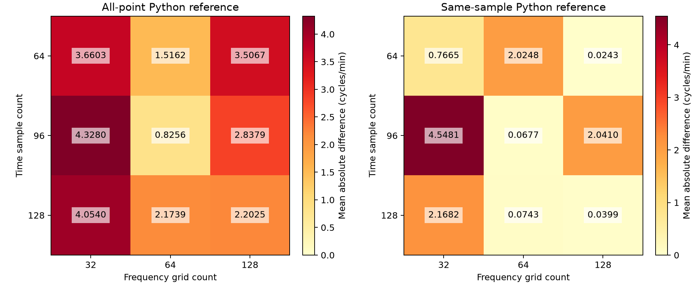
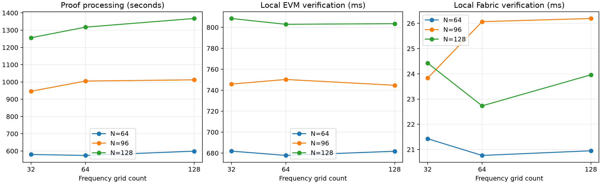
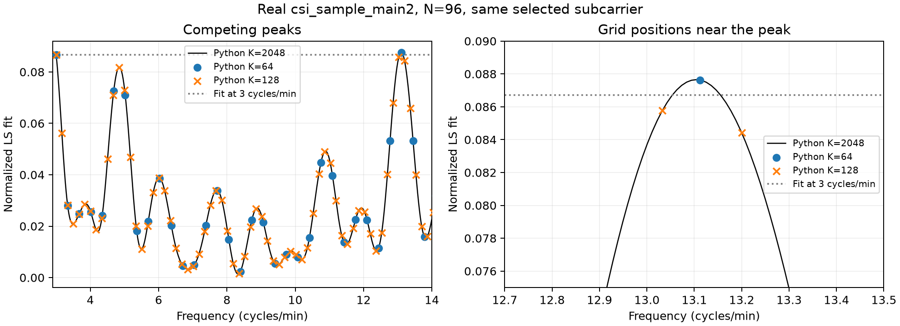

# 実測CSI：時刻点数 × 周波数グリッド数の比較

実測CSI 5件、時刻点数64・96・128 × 周波数グリッド数32・64・128の9条件。合成CSIは使用していない。
32グリッドの回路出力と台帳計測は前回の実測を再利用し、参照との差を今回の固定参照で再計算した。追加6条件は実際にコンパイル・証明生成・台帳記録・検証した。

## 固定した条件

- 前回と同じ入力JSON（全候補I/Q、時刻、量子化、nonce）。各N内ではKが変わっても入力・選択列・CSIコミットメントは同一。
- 周波数範囲：127/2540〜1026/2540 Hz（3〜24.2362周期/分）。正常帯域：0.1〜22/60 Hz（6〜22周期/分）。
- 回路周波数：f(j)=127/2540 + j × 899/[2540(K−1)]、j=0..K−1。K=32・64・128で刻みは約0.6850・0.3371・0.1672周期/分。
- 正常帯域binはK=32:5〜27、K=64:9〜56、K=128:18〜113。探索範囲や物理的判定帯域を増点に伴って広げない。
- 同式Python参照は2,048周波数に固定。元の全時刻点＋同じ選択式で選ぶ列を主参照とする。時刻は前回同様にミリ秒へ丸める。
- 「同時刻点」参照は回路と同じ時刻点・選択列・量子化CSIを使い、周波数だけを2,048点にする。グリッド近似の影響を分けるための比較。
- 正解呼吸数のラベルはない。以下はPythonとの差・一致であり、実際の呼吸判定の正解率ではない。

## Pythonとの差（全域ピーク、周期/分）

| 時刻点数 | グリッド数 | 全時刻点Pythonとの差の平均 | 同時刻点Pythonとの差の平均 | 全時刻点PythonとのisNormal一致 | 前回の独立Python選択法との差 |
|---|---|---:|---:|---:|---:|
| 64 | 32 | 3.6603 | 0.7665 | 4/5 | 5.9157 |
| 64 | 64 | 1.5162 | 2.0248 | 5/5 | 3.9941 |
| 64 | 128 | 3.5067 | 0.0243 | 4/5 | 5.8715 |
| 96 | 32 | 4.3280 | 4.5481 | 3/5 | 7.1287 |
| 96 | 64 | 0.8256 | 0.0677 | 4/5 | 3.7245 |
| 96 | 128 | 2.8379 | 2.0410 | 3/5 | 5.6708 |
| 128 | 32 | 4.0540 | 2.1682 | 3/5 | 6.8748 |
| 128 | 64 | 2.1739 | 0.0743 | 4/5 | 5.0728 |
| 128 | 128 | 2.2025 | 0.0399 | 4/5 | 5.0893 |

今回の5件で全時刻点参照との差が最小だった条件はN=96、K=64。他の収集条件での最適値を保証するものではない。
前回の独立Python選択法はfloating-mean LS・355周波数・別のサブキャリア選択式で、旧帯域内の候補は約6.4794〜21.4767周期/分。主参照の6〜22周期/分とは帯域定義も異なるため、今回の同式参照とは分けて解釈する。
**前回の表とは参照グリッドが異なるため、32グリッド行の差も数値が変わる。今回の9条件同士を比較する。**

参照を2,048から4,096周波数に増やした場合、5件のピーク差の最大は0.005670周期/分。これは参照グリッドに対する感度確認であり、正解値の保証ではない。

## 同入力・同グリッドの整数／実数Pythonとの一致

全45条件の回路出力（選択列・全域ピーク・帯域内ピーク・isNormal）は整数Python参照と一致した。実数Pythonとは、丸めにより次の差が残った。

| N / K | CSI | 全域ピーク差 | 帯域内ピーク差 | isNormal一致 |
|---|---|---:|---:|---|
| n128k32 | csi_sample_base | 0.0000 | 2.7402 | True |

## 実際の証明・記録・検証時間

| N | K | 制約数 | 証明処理 秒 | EVM記録 ms | EVM検証 ms | Fabric記録 ms | Fabric検証 ms | EVM記録gas |
|---|---|---:|---:|---:|---:|---:|---:|---:|
| 64 | 32 | 14,530,543 | 579.86 | 175.66 | 681.93 | 2164.51 | 21.43 | 1,823,238 |
| 64 | 64 | 14,841,884 | 574.34 | 195.97 | 677.79 | 2172.72 | 20.77 | 1,823,250 |
| 64 | 128 | 15,453,708 | 599.01 | 182.53 | 681.80 | 2173.21 | 20.95 | 1,823,238 |
| 96 | 32 | 21,067,362 | 946.28 | 242.50 | 745.89 | 2170.22 | 23.83 | 2,518,223 |
| 96 | 64 | 21,527,689 | 1005.38 | 300.08 | 750.28 | 2232.43 | 26.07 | 2,558,047 |
| 96 | 128 | 22,432,281 | 1012.50 | 241.49 | 744.77 | 2174.49 | 26.19 | 2,558,071 |
| 128 | 32 | 27,559,607 | 1256.22 | 300.24 | 808.46 | 2193.22 | 24.43 | 3,253,138 |
| 128 | 64 | 28,168,350 | 1317.50 | 295.36 | 802.92 | 2185.42 | 22.73 | 3,253,090 |
| 128 | 128 | 29,364,590 | 1367.68 | 295.97 | 803.52 | 2191.05 | 23.96 | 3,253,102 |

初回検証時間（未起動状態からのコールドスタートを保証する値ではない）：

| N | K | EVM初回 ms | Fabric初回 ms |
|---|---|---:|---:|
| 64 | 32 | 689.65 | 473.36 |
| 64 | 64 | 680.74 | 484.20 |
| 64 | 128 | 697.37 | 509.43 |
| 96 | 32 | 749.57 | 491.40 |
| 96 | 64 | 758.63 | 478.82 |
| 96 | 128 | 760.05 | 501.96 |
| 128 | 32 | 818.86 | 479.90 |
| 128 | 64 | 859.20 | 480.71 |
| 128 | 128 | 900.22 | 539.25 |

- 代表実測CSI csi_20260519_114943の全4,004候補を使用。各条件につき証明生成・記録1回、検証は初回＋追加10回。表は追加10回の中央値。
- 証明処理は鍵・R1CS・witness読み込み、群検査、全制約検査、Groth16生成、native検証を含む。witness作成、setup、デプロイは別。
- EVMはローカルGanache chain1337、Fabricはローカル2組織ネットワーク。Sepoliaの測定ではない。
- 検証はEVM eth_call / Fabric evaluateTransactionによる台帳側検証付き照会。新たな検証トランザクションの確定時間ではない。
- FabricのBatchTimeoutは2秒。記録待ち時間はこの設定の影響を受ける。
- K=32の時間は前回実験の値。追加条件の実行順はN64/K64→N64/K128→N96/K64→N96/K128→N128/K64→N128/K128。反復・ランダム順序による統計的な速度比較ではない。
- ホストはIntel i5-8500B、メモリ16GiB。swapとOSキャッシュ・他サービスの影響を受ける。小さな時間差をグリッド数だけの効果と解釈しない。
- Kを増やしても公開信号数はN+6のまま。新しい回路・鍵・検証器を個別配備し、実際の記録・検証と改変isNormalの拒否を全条件で確認。
- 記録gasには出力値が0か非0かによるストレージ費用の違いも含まれる。Kによる制約数増加が、そのまま台帳のgas増加になるわけではない。
- テスト用単独セットアップ。実運用のtrusted setupやインフラ費用の評価は含まない。

## 各実測CSIの出力

| CSI | N | K | 選択列 | 全域ピーク 周期/分 | 全点参照 周期/分 | 差 | isNormal |
|---|---|---|---:|---:|---:|---:|---:|
| csi_20260519_114943 | 64 | 32 | 721 | 5.0551 | 4.4005 | 0.6546 | 0 |
| csi_20260519_114943 | 64 | 64 | 721 | 4.6854 | 4.4005 | 0.2849 | 0 |
| csi_20260519_114943 | 64 | 128 | 721 | 4.8394 | 4.4005 | 0.4388 | 0 |
| csi_20260519_114943 | 96 | 32 | 2308 | 3.0000 | 4.4005 | 1.4005 | 0 |
| csi_20260519_114943 | 96 | 64 | 2308 | 6.7079 | 4.4005 | 2.3074 | 1 |
| csi_20260519_114943 | 96 | 128 | 2308 | 6.8459 | 4.4005 | 2.4454 | 1 |
| csi_20260519_114943 | 128 | 32 | 648 | 4.3701 | 4.4005 | 0.0305 | 0 |
| csi_20260519_114943 | 128 | 64 | 648 | 4.6854 | 4.4005 | 0.2849 | 0 |
| csi_20260519_114943 | 128 | 128 | 648 | 4.8394 | 4.4005 | 0.4388 | 0 |
| csi_sample_base | 64 | 32 | 44 | 20.8110 | 14.6711 | 6.1399 | 1 |
| csi_sample_base | 64 | 64 | 44 | 20.8654 | 14.6711 | 6.1943 | 1 |
| csi_sample_base | 64 | 128 | 44 | 20.8919 | 14.6711 | 6.2208 | 1 |
| csi_sample_base | 96 | 32 | 30 | 23.5512 | 14.6711 | 8.8801 | 0 |
| csi_sample_base | 96 | 64 | 30 | 14.7979 | 14.6711 | 0.1268 | 1 |
| csi_sample_base | 96 | 128 | 30 | 14.8722 | 14.6711 | 0.2011 | 1 |
| csi_sample_base | 128 | 32 | 31 | 23.5512 | 14.6711 | 8.8801 | 0 |
| csi_sample_base | 128 | 64 | 31 | 23.5621 | 14.6711 | 8.8910 | 0 |
| csi_sample_base | 128 | 128 | 31 | 23.7346 | 14.6711 | 9.0635 | 0 |
| csi_sample_base2 | 64 | 32 | 3101 | 4.3701 | 3.0000 | 1.3701 | 0 |
| csi_sample_base2 | 64 | 64 | 3101 | 4.0112 | 3.0000 | 1.0112 | 0 |
| csi_sample_base2 | 64 | 128 | 3101 | 4.1705 | 3.0000 | 1.1705 | 0 |
| csi_sample_base2 | 96 | 32 | 3048 | 3.0000 | 3.0000 | 0.0000 | 0 |
| csi_sample_base2 | 96 | 64 | 3048 | 3.0000 | 3.0000 | 0.0000 | 0 |
| csi_sample_base2 | 96 | 128 | 3048 | 3.0000 | 3.0000 | 0.0000 | 0 |
| csi_sample_base2 | 128 | 32 | 3041 | 3.0000 | 3.0000 | 0.0000 | 0 |
| csi_sample_base2 | 128 | 64 | 3041 | 3.0000 | 3.0000 | 0.0000 | 0 |
| csi_sample_base2 | 128 | 128 | 3041 | 3.0000 | 3.0000 | 0.0000 | 0 |
| csi_sample_main | 64 | 32 | 505 | 5.0551 | 4.9815 | 0.0736 | 0 |
| csi_sample_main | 64 | 64 | 505 | 5.0225 | 4.9815 | 0.0410 | 0 |
| csi_sample_main | 64 | 128 | 505 | 3.5016 | 4.9815 | 1.4799 | 0 |
| csi_sample_main | 96 | 32 | 508 | 3.6850 | 4.9815 | 1.2965 | 0 |
| csi_sample_main | 96 | 64 | 508 | 3.3371 | 4.9815 | 1.6444 | 0 |
| csi_sample_main | 96 | 128 | 508 | 3.5016 | 4.9815 | 1.4799 | 0 |
| csi_sample_main | 128 | 32 | 507 | 3.6850 | 4.9815 | 1.2965 | 0 |
| csi_sample_main | 128 | 64 | 507 | 3.3371 | 4.9815 | 1.6444 | 0 |
| csi_sample_main | 128 | 128 | 507 | 3.5016 | 4.9815 | 1.4799 | 0 |
| csi_sample_main2 | 64 | 32 | 2372 | 3.0000 | 13.0631 | 10.0631 | 0 |
| csi_sample_main2 | 64 | 64 | 2372 | 13.1125 | 13.0631 | 0.0494 | 1 |
| csi_sample_main2 | 64 | 128 | 2372 | 4.8394 | 13.0631 | 8.2237 | 0 |
| csi_sample_main2 | 96 | 32 | 2374 | 3.0000 | 13.0631 | 10.0631 | 0 |
| csi_sample_main2 | 96 | 64 | 2374 | 13.1125 | 13.0631 | 0.0494 | 1 |
| csi_sample_main2 | 96 | 128 | 2374 | 3.0000 | 13.0631 | 10.0631 | 0 |
| csi_sample_main2 | 128 | 32 | 2373 | 3.0000 | 13.0631 | 10.0631 | 0 |
| csi_sample_main2 | 128 | 64 | 2373 | 13.1125 | 13.0631 | 0.0494 | 1 |
| csi_sample_main2 | 128 | 128 | 2373 | 13.0329 | 13.0631 | 0.0302 | 1 |

## グリッドを増やしても差が増える例

実測csi_sample_main2、N=96では、同じ選択列・時刻点でグリッド上のピーク順位が変わった。以下は実数Pythonの適合度で、呼吸の正解確率ではない。

| グリッド数 | 最大適合の周波数 周期/分 | 適合度 | 2位の周波数 周期/分 | 適合度 |
|---|---:|---:|---:|---:|
| 64 | 13.112486 | 0.08762847 | 3.000000 | 0.08671384 |
| 128 | 3.000000 | 0.08671384 | 13.032860 | 0.08578558 |
| 2048 | 13.104582 | 0.08765288 | 13.094207 | 0.08761583 |

64グリッドには約13.1125周期/分の候補があるが、128グリッドの近隣候補は約13.0329と13.2001周期/分。2,048点参照の約13.1046周期/分に対して64点側の候補が近く、僅差のピーク順位が入れ替わる。グリッドは入れ子ではないため、点数だけでは差の単調減少を保証できない。

除外は前回と同じ2ファイル（候補数8,100で容量超過、破損フレーム）。入力列の切り捨てや合成データによる補完はしていない。

生の測定値・取引ID・全検証反復値：[results.json](results.json)。公開証明・鍵・配備情報・ログ：[evidence](evidence/)。
実装・再実行手順：[周波数グリッド比較手順](../../frequency-grid-comparison.md)。
計測後の整形は新規回路2ファイルの末尾空行削除のみ。計測時と保存時のソースハッシュ、元バイト列を復元できる差分をresults.jsonに残した。回路・鍵・証明・数値は変更していない。

