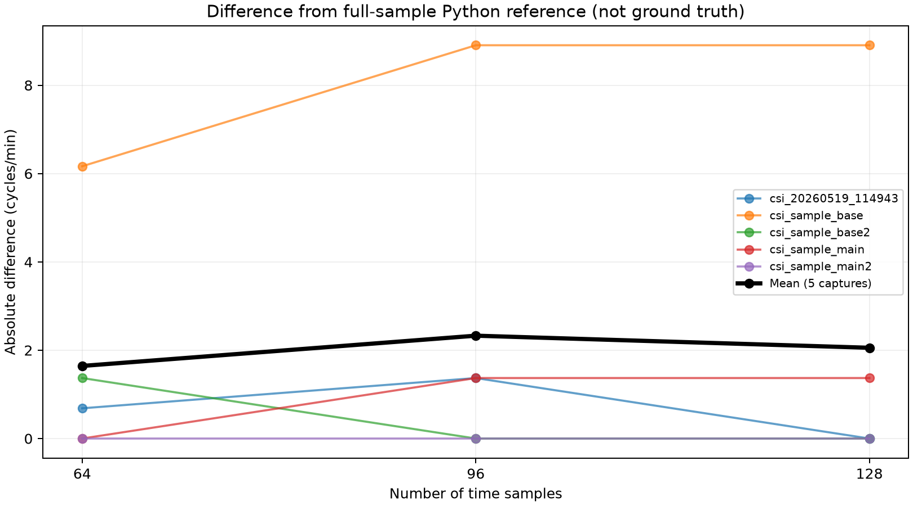
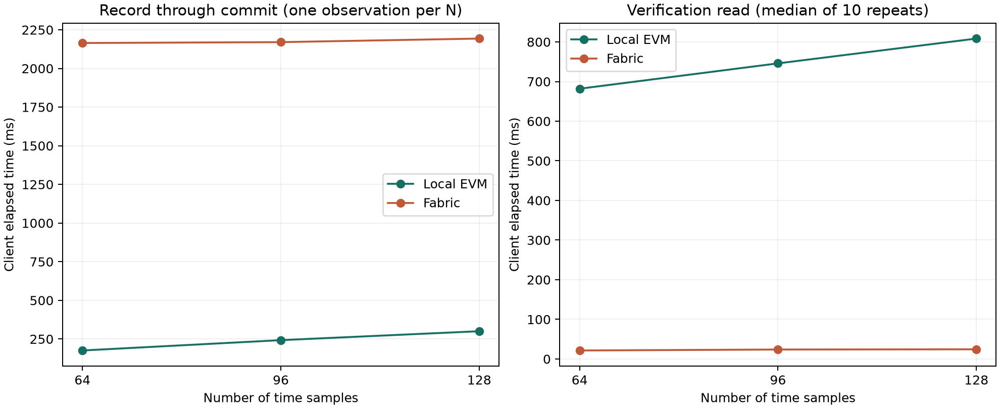

# 実測CSI：時刻点数とPythonとの差・証明記録／検証時間

合成CSIは使用していない。64・96・128点を同じ実測5ファイルで比較した。

## 使用した実測データ

全点数は最頻CSI幅の抽出とミリ秒時刻の重複除去を行った後の値。全点Pythonは、この全点数で計算する。

| CSI | 全点数 | 候補列数 | 観測区間（秒） |
|---|---:|---:|---:|
| csi_20260519_114943 | 150 | 4004 | 53.217 |
| csi_sample_base | 270 | 53 | 58.088 |
| csi_sample_base2 | 4436 | 4004 | 59.451 |
| csi_sample_main | 275 | 4004 | 57.266 |
| csi_sample_main2 | 4645 | 4004 | 59.463 |

## Python参照との差

同じ周波数グリッド・同じ電力波形・同じ選択式で比較。BPM差は推定周期の差であり、正解呼吸数との誤差ではない。

| 点数 | 同入力の整数Python一致 | 同入力の実数Python全域ピーク差の平均 | 全点Pythonとの選択一致 | 全点PythonとのisNormal一致 | 全点Pythonとの全域ピーク差の平均 |
|---|---:|---:|---:|---:|---:|
| 64 | 5/5 | 0.0000 | 0/5 | 5/5 | 1.6441 |
| 96 | 5/5 | 0.0000 | 1/5 | 4/5 | 2.3291 |
| 128 | 5/5 | 0.0000 | 0/5 | 4/5 | 2.0551 |

今回の5件で全点Pythonとの平均周波数差が最小だったのは64点。平均差は点数の増加に対して単調には減少しなかった。
これはこの実測データと選択式・間引き方での結果であり、他の収集条件での最適点数を確定する結果ではない。
96点は64点に対して、全点参照との差が縮小したCSIが1件、同じものが1件、拡大したものが3件。
128点は64点に対して、全点参照との差が縮小したCSIが2件、同じものが1件、拡大したものが2件。

### 補助出力：正常帯域内のピーク

`estimatedFrequencyBin`は正常帯域内に限定したピーク。全域ピーク`globalPeakFrequencyBin`とは別の出力である。以下は同じ入力を使う実数Pythonとの差。

| 点数 | 正常帯域内ピークbin一致 | 正常帯域内ピーク差の平均（周期/分） |
|---|---:|---:|
| 64 | 5/5 | 0.0000 |
| 96 | 5/5 | 0.0000 |
| 128 | 4/5 | 0.5480 |

128点の`csi_sample_base`では回路bin 17、実数Python bin 13で、差は2.7402周期/分。全域ピークは一致、isNormalは一致。整数Pythonとはこの補助出力も一致している。

列番号の完全一致だけでは、近いスコアを持つ候補の入れ替わりを評価できないため、選択列を全点Pythonのスコアで再評価した値も示す。
比率は「回路が選んだ列の全点スコア ÷ 全点Pythonの最大スコア」。全点で適格条件を満たさない列のスコアは0。1に近いほどこの選択基準では近く、呼吸判定の正解率ではない。

| 点数 | 全点でも適格な選択列 | 全点最大スコアに対する比率の平均 | 同じ選択列を全点で処理したPythonとの周波数差の平均 |
|---|---:|---:|---:|
| 64 | 4/5 | 0.6394 | 2.3291 |
| 96 | 3/5 | 0.5717 | 2.3291 |
| 128 | 2/5 | 0.3169 | 4.1102 |

## 前回の独立Python選択法との比較

前回使用した、呼吸帯域のfloating-mean Lomb–Scargle適合度を重視するPython選択法も、今回と同じ実測ファイル・共有スケールで再計算した。
この参照は元の全時刻点、実数演算、355点の周波数グリッドを使う。回路とは選択式・LSモデル・周波数刻みが異なるため、上の同式比較とは区別する。

| 回路の点数 | 全点スペクトルPythonとの選択一致 | isNormal一致 | 周波数差の平均（周期/分） |
|---|---:|---:|---:|
| 64 | 0/5 | 3/5 | 5.9157 |
| 96 | 0/5 | 2/5 | 7.1287 |
| 128 | 0/5 | 2/5 | 6.8748 |

Pythonが実際の呼吸をより正確に検出しているかは、正解ラベルがないため判定できない。この表も参照法への一致・差である。

## 各CSIの出力

| CSI | 点数 | 回路の選択列 | 全点Pythonの選択列 | 回路の全域ピークbin | 全点Pythonの全域ピークbin | 周波数差（周期/分） |
|---|---:|---:|---:|---:|---:|---:|
| csi_20260519_114943 | 64 | 721 | 723 | 3 | 2 | 0.6850 |
| csi_20260519_114943 | 96 | 2308 | 723 | 0 | 2 | 1.3701 |
| csi_20260519_114943 | 128 | 648 | 723 | 2 | 2 | 0.0000 |
| csi_sample_base | 64 | 44 | 30 | 26 | 17 | 6.1654 |
| csi_sample_base | 96 | 30 | 30 | 30 | 17 | 8.9055 |
| csi_sample_base | 128 | 31 | 30 | 30 | 17 | 8.9055 |
| csi_sample_base2 | 64 | 3101 | 3037 | 2 | 0 | 1.3701 |
| csi_sample_base2 | 96 | 3048 | 3037 | 0 | 0 | 0.0000 |
| csi_sample_base2 | 128 | 3041 | 3037 | 0 | 0 | 0.0000 |
| csi_sample_main | 64 | 505 | 506 | 3 | 3 | 0.0000 |
| csi_sample_main | 96 | 508 | 506 | 1 | 3 | 1.3701 |
| csi_sample_main | 128 | 507 | 506 | 1 | 3 | 1.3701 |
| csi_sample_main2 | 64 | 2372 | 2376 | 0 | 0 | 0.0000 |
| csi_sample_main2 | 96 | 2374 | 2376 | 0 | 0 | 0.0000 |
| csi_sample_main2 | 128 | 2373 | 2376 | 0 | 0 | 0.0000 |

## 回路規模とwitness

| 点数 | R1CS制約数 | 代表CSIのwitness計算（秒） |
|---|---:|---:|
| 64 | 14,530,543 | 19.558 |
| 96 | 21,067,362 | 28.430 |
| 128 | 27,559,607 | 37.361 |

## 実際の証明・台帳計測

代表実測CSI `csi_20260519_114943.csi` の全4,004候補を使用。各点数で実際にGroth16証明を作成し、両台帳に同じ証明を記録した。

| 点数 | 公開信号数 | 証明処理（秒） | EVM記録確定（ms） | Fabric記録確定（ms） | EVM検証中央値（ms） | Fabric検証中央値（ms） | EVM記録gas |
|---|---:|---:|---:|---:|---:|---:|---:|
| 64 | 70 | 579.858 | 175.66 | 2164.51 | 681.93 | 21.43 | 1,823,238 |
| 96 | 102 | 946.278 | 242.50 | 2170.22 | 745.89 | 23.83 | 2,518,223 |
| 128 | 134 | 1256.223 | 300.24 | 2193.22 | 808.46 | 24.43 | 3,253,138 |

初回測定値も別に示す。初回は未起動状態からのコールドスタートを保証する値ではない。

| 点数 | EVM初回検証（ms） | Fabric初回検証（ms） | ローカルsnarkjs検証中央値（ms） |
|---|---:|---:|---:|
| 64 | 689.65 | 473.36 | 8.52 |
| 96 | 749.57 | 491.40 | 8.59 |
| 128 | 818.86 | 479.90 | 8.52 |

- 記録は各条件1回の単発値。検証は初回＋追加10回、表は追加10回の中央値。独立した患者10人での測定ではない。
- 証明処理時間はR1CS・witness・鍵の読み込み、鍵の群検査、全制約検査、証明生成、nativeローカル検証を含む。witness作成、鍵生成、デプロイは別。
- EVMはGanache chainId=1337、Fabricはローカル2組織ネットワーク。Sepolia実測ではなく、Fabricインフラ費用も含まない。
- EVMとFabricの差には、ローカル実装・ブロック生成設定・初回初期化の違いも含まれる。実測値をそのままSepolia対Fabricの性能差として扱わない。
- 実稼働チャネルから取得したFabric設定はBatchTimeout=2秒、MaxMessageCount=10。今回の単発記録の待ち時間は、この設定の影響を受ける。
- 検証はEVM eth_call / Fabric evaluateTransactionで、記録済み証明を台帳側で検証する照会時間。新たな検証トランザクションの確定時間ではない。
- EVMのgas見積もりは記録タイマー外。記録時間は送信から成功receiptまで、ポーリング100ms。Fabricはendorse開始からcommit成功まで。
- 実行順は96→128→64点。重いコンパイル・証明処理は直列実行し、台帳測定中に別点数のコンパイルを走らせない。
- ホストはIntel Core i5-8500B・メモリ16GiB。証明処理中にOSのswap使用を確認したため、証明時間にはメモリ容量による影響も含まれる。環境と観測値はresults.jsonに保存。
- 鍵生成はテスト用の単独セットアップ。既存台帳とは別の検証器・chaincode namespaceを使用。

## 条件・限界

各ファイルで観測区間・全候補列・量子化スケールを固定し、観測番号に対する等間隔間引きの点数のみ変更した。各点数の行集合は入れ子ではない。
Python参照は電力を平均除去後、cos/sinを当てはめる現行回路と同じモデル。周波数ごとの定数項を追加する別のfloating-mean選択法とは区別する。
全32binのグリッドは固定のため、点数を増やしても周波数の刻み自体は細かくならない。
選択式のDは隣接する採用時刻点間の差分であり、点数を変えると比較する間隔も変わる。したがって、全点参照との差にはサンプリングとスコアの時間間隔依存性も含まれる。
正解ラベルがないため、Pythonへの一致改善を実際の呼吸判定精度の向上と同一視しない。

除外ファイル：

- `rx_2_260416_194935`: candidate_capacity_exceeded
- `rx_2_260416_195009`: PicoScenesフレーム長が不正です: offset=293586524, size=32865

詳細数値・取引ID・初回検証時間・繰り返し全測定値は [results.json](results.json)。
実装・比較条件・再実行コマンドは [比較手順](../../sample-count-comparison.md)。
コンパイル・証明・配備のログは [logs](logs/) に保存した（公開用コピーでは色コードと行末空白を除去）。

