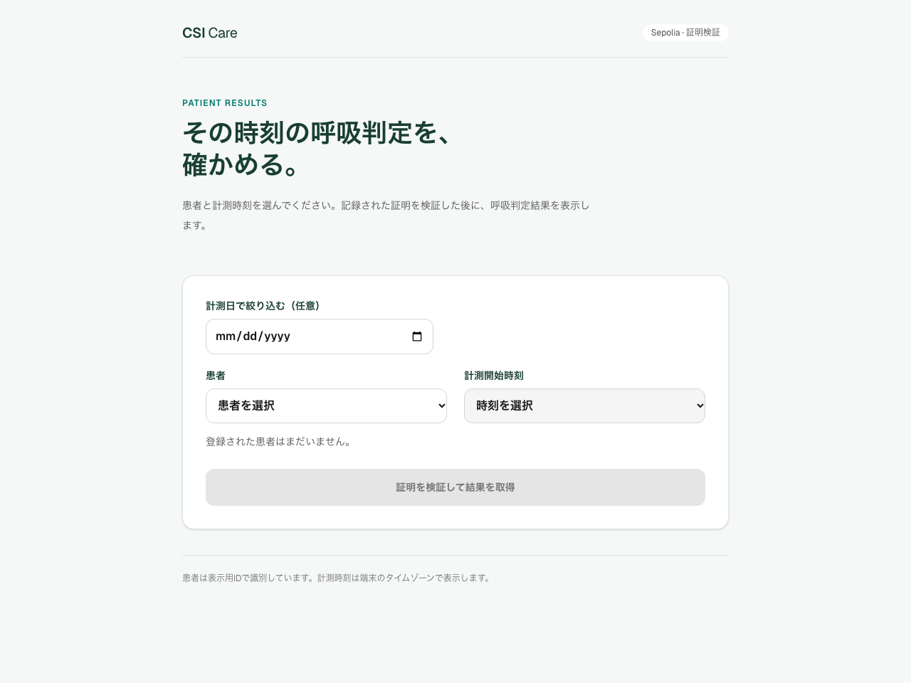

# Sepolia公開検証UIの準備（2026-11-24）

Macで動く専用APIと本番ビルドのUIを、閲覧機能だけに限定したHTTPS URLで公開した。

URL：<https://approaches-beside-trading-travelers.trycloudflare.com>

**現在はSepoliaのテストETH補充待ち。実デプロイ・実記録・Sepolia上での検証は未完了。** 患者一覧は空で、結果はまだ表示できない。

## 変更内容

- Sepolia専用の起動・準備・デプロイ・記録・検証コマンドを追加。専用SQLiteキューとポートを使用する。
- 保存済み実CSI証明の整合性・検証鍵・Groth16検証をオフラインで確認する処理を追加。
- デプロイ時の手数料上限に使うfeeを実際の送信にも固定。送信状態をjournalに保存し、重複実行を停止する。
- 公開nginxで患者一覧・計測一覧・検証だけを許可。公開画面から収集管理リンクを除去。
- 検証成功時にSepoliaのブロック番号・記録トランザクションへのリンクを表示。
- 本番ビルドで検出されたNext.jsの問題に対応し、Next.jsとeslint-config-nextを16.4.6へ更新。

## 完了した確認

| 確認 | 結果 |
| --- | --- |
| 公開HTTPS URLの画面・患者一覧API | HTTP 200 |
| 公開経由の患者追加 | HTTP 403 |
| 公開経由の管理画面・CSI送信・OpenAPI | HTTP 404 |
| Playwrightで公開画面を表示 | ブラウザエラーなし、管理リンクなし |
| 実CSIから保存済みの証明 | オフラインGroth16検証成功、70公開入力・4004候補 |
| Verifierコンパイル | runtime 7,915 bytes |
| コントラクト回帰テスト | 6件成功（ローカルテスト。Sepolia実測ではない） |
| Observation関連バックエンドテスト | 22件成功 |
| フロントエンド | lint・type-check・production build成功 |
| production依存のnpm audit | 既知脆弱性0件（実行時点） |

コントラクトテストには実CSIの保存済み証明の検証、書込権限、不在記録、公開入力改変時の拒否を含む。今回の確認では新しい証明生成も合成CSIの生成も行っていない。

証跡：`browser-check.json`、`public-access-check.json`、`proof-readiness.json`、`sepolia-readiness.json`。

次の作業：2ウォレットへの入金確認→Sepoliaデプロイ→実証明の記録→公開URL経由で結果の取得→トランザクション・実測時間・スクリーンショットを追記。

操作手順は [sepolia-mac-verification.md](../../sepolia-mac-verification.md) を参照。
