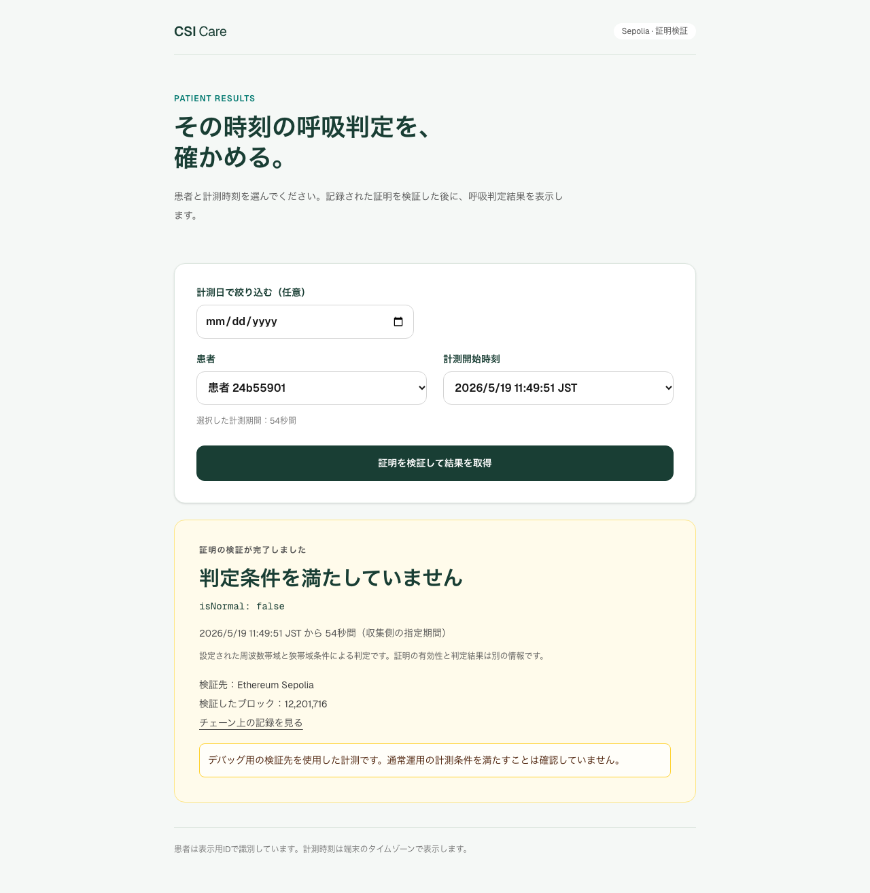

# Sepolia公開検証UI・実チェーンでの検証完了（2026-11-24）

Macで動く専用APIと本番ビルドのUIを、閲覧機能だけに限定したHTTPS URLで公開した。

URL：<https://approaches-beside-trading-travelers.trycloudflare.com>

**18:24 JST、実デプロイ・実証明の記録・Sepolia上での検証と、公開URLからの結果取得に成功した。** 保存済みの実CSI証明を使っている。今回新たにCSIを取得したり、証明を生成し直したりはしていない。

公開画面で「患者 24b55901」→「2026/5/19 11:49:51 JST」→「証明を検証して結果を取得」を選ぶ。検証後の公開出力は `isNormal: false`。証明が無効という意味ではなく、検証に成功した証明の判定値。

準備時点の空の画面は [public-awaiting-record.png](public-awaiting-record.png) に保存している。`browser-check.json` と `sepolia-readiness.json` は入金前の履歴、最新の成功証跡は `browser-verified.json` と `sepolia-readiness-funded.json`。

## 入金・実デプロイ・記録

デプロイ用で受け取った0.05 test ETHから、0.01を記録用に送金し、両方の残高を確保した。現在追加のFaucet操作は不要。

| 処理 | Sepolia上の記録 |
| --- | --- |
| 記録用への分配 | [送金トランザクション](https://sepolia.etherscan.io/tx/0x33935dcf5aa0a32c398fadaa364892dfac098c361267824d4623700e6e256862) |
| Groth16 Verifier | [`0x760Dc28a9be97d737e6b37BB8F6C5b7512ddeDc3`](https://sepolia.etherscan.io/address/0x760Dc28a9be97d737e6b37BB8F6C5b7512ddeDc3) |
| 記録・検証コントラクト | [`0x60BA83318d2B75575cdc5F9B912fF688bB7B745b`](https://sepolia.etherscan.io/address/0x60BA83318d2B75575cdc5F9B912fF688bB7B745b) |
| 実証明の記録 | [記録トランザクション](https://sepolia.etherscan.io/tx/0xe37695fa75ed5961371a8273de3038bb94c2deb3a1edb0eb53b39f57ae299b2d)、block `12201715` |

## 今回の実測（各1回、性能比較の平均ではない）

| 測定項目 | 値・範囲 |
| --- | --- |
| 記録処理の監視開始→workerが記録済みになるまで | 約35.18秒。既存証明を使用、RPC処理・2 confirmation・workerの再確認間隔を含む。DBを1秒間隔で監視 |
| APIで使う検証読出し処理 | 約262.51 ms。metadata・ブロック整合性確認・verifyObservation呼出しを含み、接続オブジェクトの初期化は除外 |
| 公開UIの検証ボタン→HTTP応答JSON取得まで | 約891.27 ms。トンネル・API・RPCを含む |
| Verifierの直接呼出し | 約40.41 ms。RPC往復を含む `eth_call`、EVM実行時間単独ではない |
| 証明記録のgasUsed | 8,850,850 |
| 証明記録のeffectiveGasPrice | 21 wei/gas |
| 証明記録の実費 | 185,867,850 wei = 0.00000000018586785 Sepolia ETH |
| 読出し検証の支払ガス代 | なし（`eth_call`、検証トランザクションは送っていない） |

実費はこの時点のSepolia receipt値。Mainnetの料金推計やFabricとの性能比較ではない。確認数2はfinalized確定を意味しない。

実Sepolia上のread-only呼出しで、元の実証明が有効、公開出力を変更すると無効、不在記録の検証はrevert、権限のない記録要求はrevertすることも確認した。不正な記録を実際に書き込むことはしていない。

## 変更内容

- Sepolia専用の起動・準備・デプロイ・記録・検証コマンドを追加。専用SQLiteキューとポートを使用する。
- 保存済み実CSI証明の整合性・検証鍵・Groth16検証をオフラインで確認する処理を追加。
- デプロイ時の手数料上限に使うfeeを実際の送信にも固定。送信状態をjournalに保存し、重複実行を停止する。
- 公開nginxで患者一覧・計測一覧・検証だけを許可。公開画面から収集管理リンクを除去。
- 検証成功時にSepoliaのブロック番号・記録トランザクションへのリンクを表示。
- 本番ビルドで検出されたNext.jsの問題に対応し、Next.jsとeslint-config-nextを16.4.6へ更新。

## 完了した確認

| 確認 | 結果 |
| --- | --- |
| 公開HTTPS URLの画面・患者一覧API | HTTP 200 |
| 公開経由の患者追加 | HTTP 403 |
| 公開経由の管理画面・CSI送信・OpenAPI | HTTP 404 |
| Playwrightで公開画面を表示 | ブラウザエラーなし、管理リンクなし |
| Playwrightで公開画面から実証明を検証 | 成功、Sepolia・ブロック・トランザクションリンク表示 |
| 検証前の出力抑制 | 計測一覧APIにisNormalなし、結果欄は検証成功後に表示 |
| 実CSIから保存済みの証明 | オフラインGroth16検証成功、70公開入力・4004候補 |
| Verifierコンパイル | runtime 7,915 bytes |
| コントラクト回帰テスト | 6件成功（ローカルテスト。Sepolia実測ではない） |
| Observation関連バックエンドテスト | 22件成功 |
| フロントエンド | lint・type-check・production build成功 |
| production依存のnpm audit | 既知脆弱性0件（実行時点） |

コントラクトテストには実CSIの保存済み証明の検証、書込権限、不在記録、公開入力改変時の拒否を含む。今回の確認では新しい証明生成も合成CSIの生成も行っていない。

成功証跡：`browser-verified.json`、`onchain-checks.json`、`smoke-result.json`、`record-timing.json`、`deployment-journal.json`、`deployment-manifest.json`、`funding-transfer.json`、`sepolia-readiness-funded.json`。秘密鍵・署名済み送信データ・SQLiteキューは含めていない。

公開URLのブラウザ確認はMacからHTTPS公開経路を使って実行した。ユーザー所有の別PCからの操作は、同じURLで試せる状態。Quick Tunnelのため、Macやトンネルが停止すると利用できなくなり、再起動時はURLが変わる。

操作手順は [sepolia-mac-verification.md](../../sepolia-mac-verification.md) を参照。
