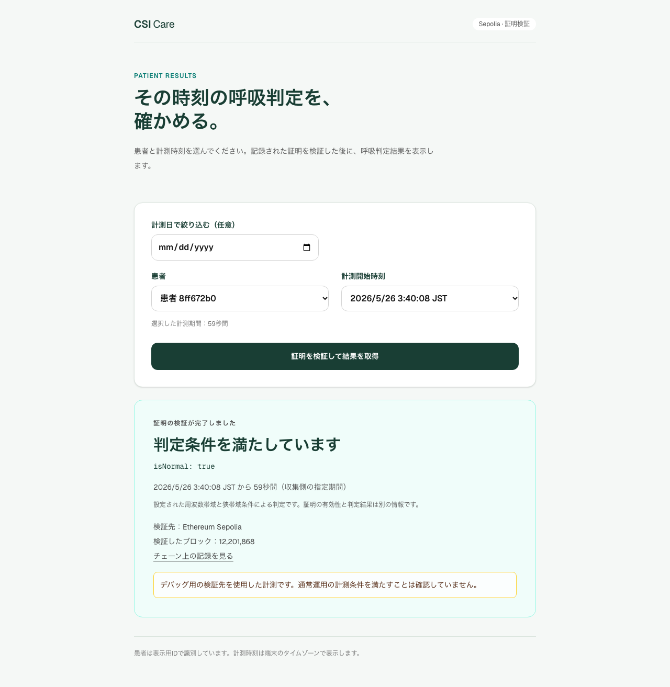

# 実CSIによるisNormal=trueのSepolia検証

目的は、既存のfalseの例に加え、同じ回路・検証鍵・Sepoliaコントラクトでtrueの例を検証すること。

**完了：2026-11-24 18:57 JST、実CSIから新しい証明を生成し、Sepoliaへの記録と公開画面での検証に成功した。出力は `isNormal: true`。**



記録トランザクション：[`0xb4b19a6e62ffa6bf500c6623d79552c5da85b9d36a8d79c6c6f1e1e52534bfac`](https://sepolia.etherscan.io/tx/0xb4b19a6e62ffa6bf500c6623d79552c5da85b9d36a8d79c6c6f1e1e52534bfac)。記録ブロックは `12201866`。

前回の `isNormal: false` も同じ公開画面で再検証に成功した。今回は保存済み証明の再利用ではなく、認証付き収集APIへの元CSIアップロードから通常のworker処理を通した。

## 入力と選定理由

- 実ファイル：`sampledata/csi_sample_base.csi`
- SHA256：`170b087573307c8edcdd5b62b8b6268b82e0af5243d62e2d60b0338ad7da2e71`
- 過去の実CSI評価 `2026-11-09-selection-comparison/results.json` で、現在と同じ64時刻・32周波数グリッドのWASMが `isNormal=1` を返したため選定した。
- ファイルは複数のCSI列数を含む。既存parserが最多フレーム数の形式を選び、53列・367フレームを使用。1 ms単位の重複時刻除去後は270時刻、その中から通常の整形処理で64時刻を選ぶ。
- 53列すべてを既存の共通スケールで量子化し、4,004候補容量の回路へ入力。残りは無効候補としてパディングする。サブキャリアは回路内で選択される。
- サンプルの時刻範囲は58.088秒。APIへ指定した収集期間は切り上げた59秒。
- 計測開始：2026-05-26 03:40:08 JST。ファイル内の時刻を使用。
- 正解ラベルは不明。ファイル名のbaseを根拠に「正常呼吸」「無人環境」などの状態を推定しない。

trueの候補を選んだ機能確認であり、無作為な精度評価ではない。isNormal=trueを実際の呼吸の正常性が確認されたことと同一視しない。合成CSI、波形の加工、時間軸の引き伸ばし、回路・判定閾値の変更は行っていない。通常の読み取り・時刻点選択・量子化は行っている。

## 今回通した処理

1. 元の実CSIを既存の `prepare_capture` で読み、出所ハッシュと計測時刻を確認。
2. ローカルの運用者認証付き `POST /api/v2/observations/patients` で新しい表示用IDを作成。
3. `POST /api/v2/observations/captures` へ元の `.csi` を送信。`ledger=evm`、`proof_profile=adaptive4004` を指定。
4. 通常のworkerで入力整形、アーティファクトのハッシュ確認、Circom witness、ネイティブGroth16証明生成、snarkjs検証を実行。
5. 同じSepolia記録コントラクトへ送信し、2 confirmationを待つ。
6. 公開WebUIで患者・時刻を選び、Sepoliaの `verifyObservation` を呼び出して結果を取得。

今回の表示用IDは患者 `8ff672b0`。患者IDは画面用に新しく発行したもので、以前の記録と実際の被験者が同一か別人かを証明するものではない。

## 判定式

現在の回路は、選択列の全探索帯域における最大ピークのbin番号が `5 <= bin <= 27` のとき `isNormal=1` とする。

```text
周波数[Hz] = (127 + 29 × bin) / 2540
isNormal = (globalPeakFrequencyBin >= 5)
           AND (globalPeakFrequencyBin <= 27)
```

今回の新しい証明も選択列44（0始まり）、bin 26、約0.346850 Hz（約20.811周期/分）だった。生成された公開信号とwitnessの公開部分が完全一致すること、およびチェーンから取得する判定値がtrueであることを照合済み。周期/分はCSI変動の推定周期であり、実測呼吸数の正解値ではない。

## 公開画面での確認

URL：<https://approaches-beside-trading-travelers.trycloudflare.com>

日付フィルターは空欄にして、患者と時刻を選ぶ。Quick TunnelのためMac・API・UI・Docker・トンネルの稼働が必要。

| 表示用患者 | 計測時刻（JST） | 用途 |
| --- | --- | --- |
| 患者 24b55901 | 2026/5/19 11:49:51 | 前回のfalseの例 |
| 患者 8ff672b0 | 2026/5/26 03:40:08 | 今回のtrueの例（検証成功） |

検証前には計測一覧APIにisNormalを含めず、画面にも結果を表示しない。患者を切り替えたら以前の結果を消し、新しく検証することを確認済み。

## 実測値（今回1回）

| 項目 | 値 |
| --- | --- |
| 入力整形 | 0.653秒 |
| アーティファクト整合性確認 | 19.912秒 |
| Circom witness生成 | 20.252秒 |
| ネイティブGroth16処理 | 662.655秒 |
| snarkjsによる生成証明の独立検証 | 0.313秒 |
| 証明処理合計（入力整形を除く） | 703.132秒、約11分43秒 |
| アップロード開始→worker記録完了の観測 | 738.176秒、約12分18秒 |
| submitted観測→recorded観測 | 32.078秒 |
| 公開WebUIの検証ボタン→HTTP応答 | 743.54 ms |
| 記録コントラクトの直接検証読出し | 49.98 ms |
| 記録gasUsed | 8,958,746 |
| effectiveGasPrice | 18 wei/gas |
| 記録実費 | 161,257,428 wei = 0.000000000161257428 Sepolia ETH |
| 閲覧時の支払ガス代 | なし（eth_call） |

submitted/recordedはSQLiteを2秒間隔で監視した値。記録時間はworkerの再確認待ち・RPC・2 confirmation待ちを含む。直接検証時間もRPC往復を含み、EVM内部の計算時間単独ではない。証明生成や記録の再試行は0回。前回の保存済み証明の記録時間と、今回の新規証明生成を含む総時間を混同しない。

## 確認したことと証跡

- 生成中の公開APIはHTTP 202と処理状態だけを返し、isNormalを返さない：`before-recording-check.json`
- 新しい公開証明・70公開信号・生成時間：`proof-bundle.json`
- 元CSIハッシュ、実際の公開出力、記録receipt：`input-metadata.json`、`result.json`
- 処理状態の推移：`timing.json`
- 公開UIでtrueを取得し、患者切替後に以前のfalseを再検証。ブラウザエラーなし：`browser-verified.json`
- 実Sepoliaのread-only呼出しで、記録済み証明はtrue、元の証明は有効、isNormalだけを0に改変すると無効：`onchain-checks.json`
- [証明生成中の画面](proof-generating.png)、[検証前](before-verification.png)、[true表示・PC](public-isnormal-true.png)、[true表示・スマートフォン幅](public-isnormal-true-mobile.png)

使用した回路、鍵、コントラクト、API、worker、UIの実装は変更していない。今回の変更ファイルは実行結果・スクリーンショット・手順の追記。フロントエンドのlint/type-checkも成功。元CSI・秘密鍵・運用者トークン・private witnessはコミットしていない。
