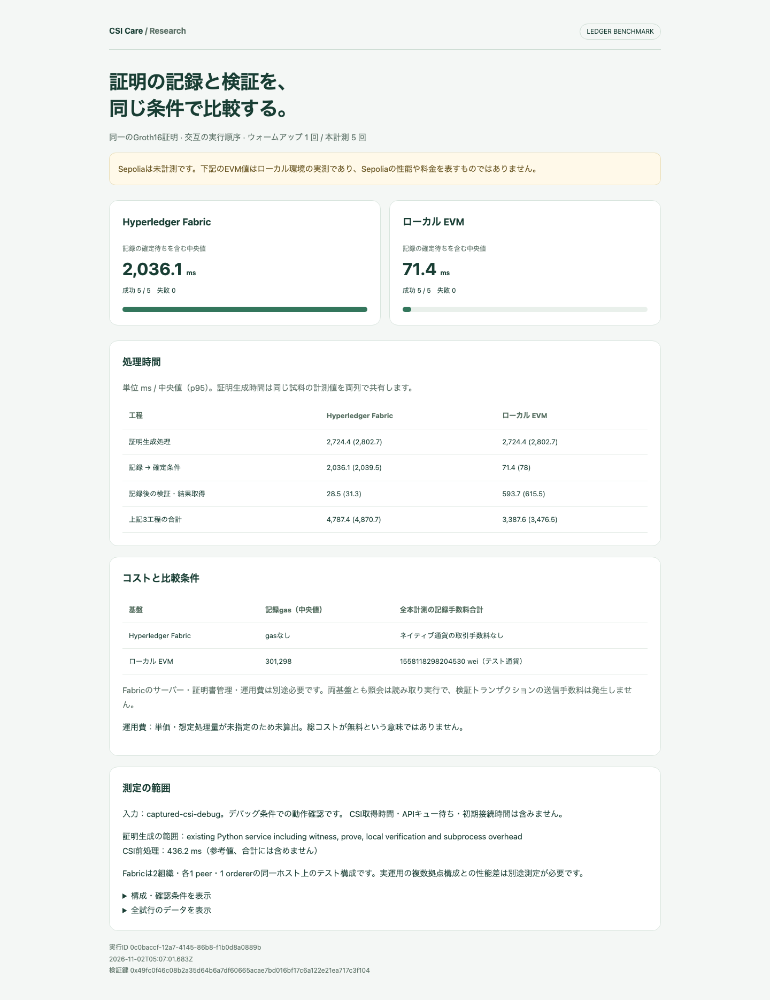
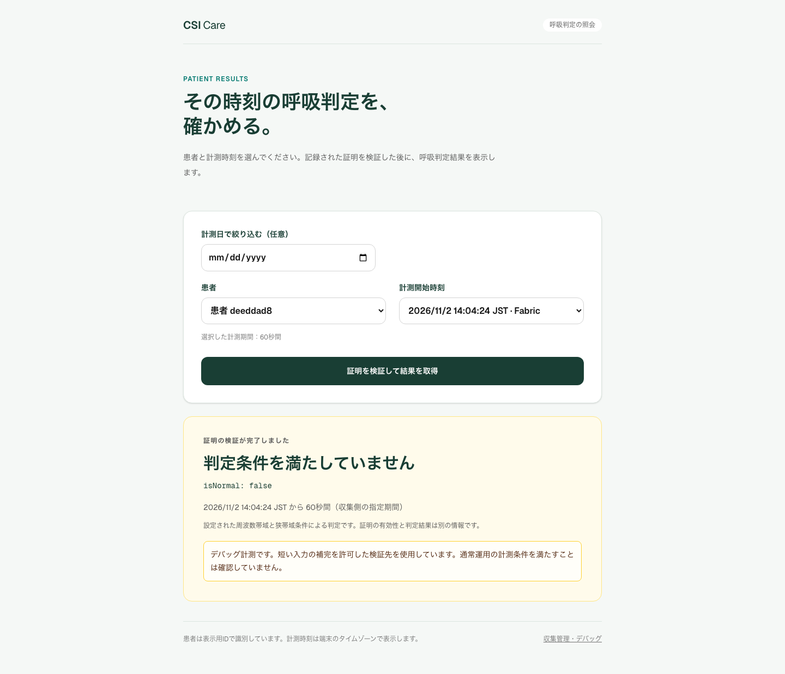
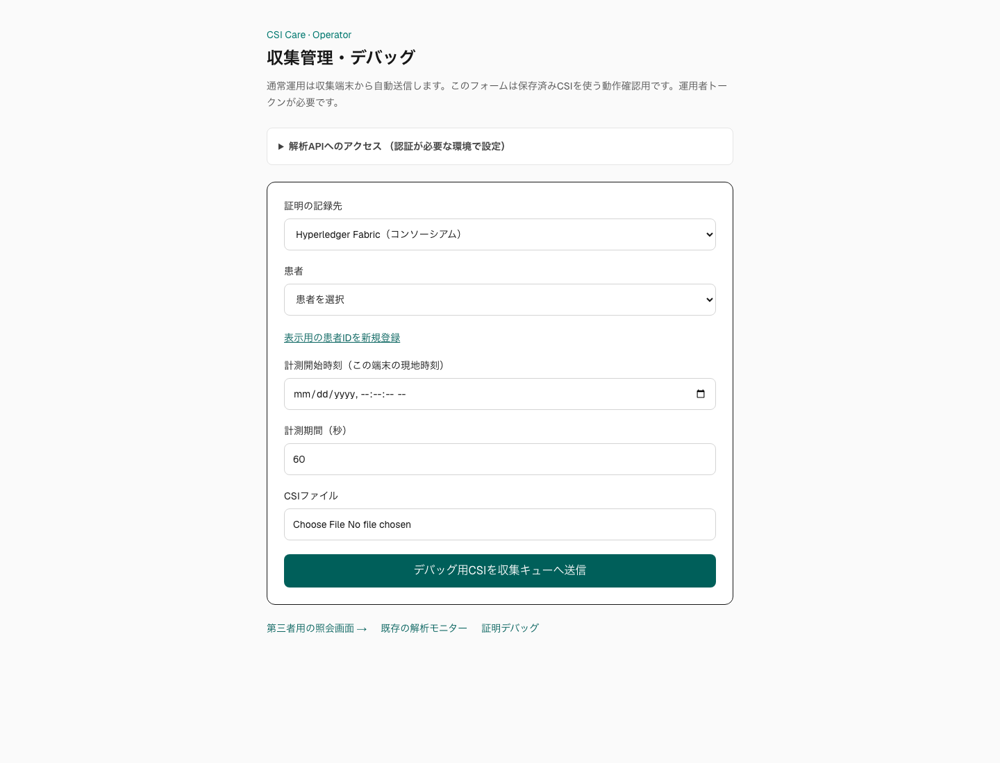
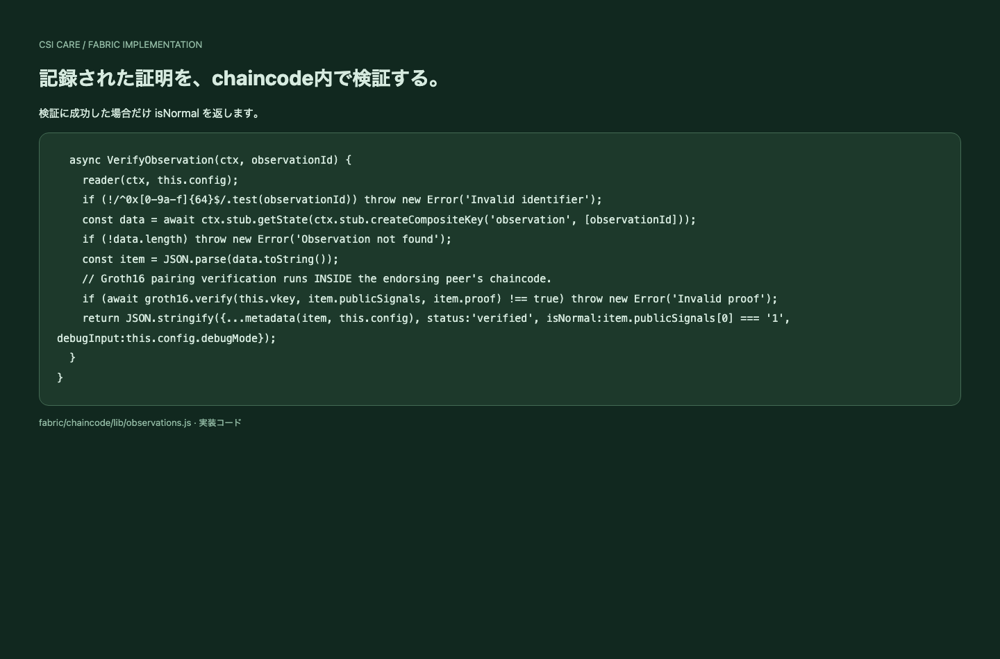

# Fabric追加・比較計測の変更差分

2026-11-02。既存のSepolia/EVM・研究/デバッグ画面を残して、Fabricの記録・chaincode検証・患者照会を追加しました。**Sepoliaは未計測**です。比較コマンドはSepoliaにも対応していますが、RPC・テストETH・デプロイ設定が必要です。

## 見るもの

- [操作・構成・Sepolia測定手順](../../FABRIC_COMPARISON.md)
- [ブラウザで開く比較レポート](evidence/comparison-report.html)
- [実CSI比較の全データ](evidence/csi-summary.json) / [CSV](evidence/comparison-raw.csv)
- [今回のコード差分](implementation.patch)（画像・lockfileは省略）
- [第三者APIの実結果](evidence/api-csi-result.json) / [実ネットワークの拒否・再送テスト](evidence/network-tests.json)

## 測定結果

保存済みCSI（150サンプル、debug paddingを許可）から6つのランダム化Groth16証明を生成。1回をウォームアップ、5回を本計測。各試行は同じ証明・metadataを両基盤に送信し、順序を交互に変更。両者とも本計測5/5成功。

| 工程・中央値 | Fabric | ローカルEVM（Sepoliaではない） |
|---|---:|---:|
| 証明生成処理（既存Pythonサービス） | 2,724.4 ms | 同じ証明生成値 |
| 記録→確定条件 | 2,036.1 ms | 71.4 ms |
| 記録後の検証・結果取得 | 28.5 ms | 593.7 ms |
| 上記3工程の合計 | 4,787.4 ms | 3,387.6 ms |
| 記録gas | 該当なし | 301,298 |

証明生成はローカル検証・子プロセス起動も含むサービス呼び出し全体。CSI前処理436.2 msは別測定で上記合計に含めません。合計の中央値は各工程の中央値の和ではありません。p95・手数料の各試行値はJSON/HTMLに収録。Fabricの約2秒はこのtest-networkのブロック作成設定等を含む値で、性能限界や本番SLAではありません。ローカルEVMは即時採掘・1 confirmationで、Sepoliaとは確定条件が異なります。

Fabricにはネイティブ通貨の取引料金がありませんが、サーバー・CA・運用費が必要です。今回の料金データはローカルEVMのテスト通貨です。金銭コストやSepoliaの料金を推定したものではありません。

## 実装ファイル

| 対象 | 変更内容 |
|---|---|
| `fabric/chaincode/lib/observations.js` | Record / Verify / Metadata、MSPと証明書による書き込み制限、再送・重複保護 |
| `fabric/chaincode/lib/proof.js` | 正規化、座標/公開信号の検査、EVMと共通のproofDigest |
| `fabric/gateway.mjs`, `gateway-server.mjs` | TLS Gateway、VALID commit待ち、reader/writer別のbridge |
| `backend/app/services/fabric_observation.py` | 記録ワーカーと検証APIのFabric adapter、患者/時刻/transaction/deployment照合 |
| `backend/app/services/observation_store.py` | ledger列の追加、既存行はevm、再送でledger変更不可 |
| `backend/app/api/endpoints/observations.py` | multipart ledger選択、記録先ごとの検証ルーティング |
| `frontend/app/capture/page.tsx` | 既存画面に記録先選択を追加 |
| `frontend/app/patients/PatientResults.tsx` | Fabric計測時刻の識別、検証後だけ結果表示する既存動作を共用 |
| `scripts/capture_observation.py` | CSI_LEDGERとスプールへの保存 |
| `fabric/benchmark/` | CSI/合成信号fixture生成、同条件比較、JSONL/CSV/HTML、運用費の明示的な仮定 |
| `fabric/scripts/` | ネットワーク起動、公開chaincodeパッケージ作成、bridge/API起動、スクリーンショット保存 |

## 検証結果

- Backend：170 passed。Fabric受け付け・再送先固定・応答不一致・障害時の結果非表示を含む。
- Frontend：lint / type-check成功、17 unit tests passed。
- Fabric / 集計：9 unit tests passed。
- 実Fabric：Org1の記録→両組織endorse→VALID commit、Org2の照会。valid true/false、公開信号改ざん、権限外書き込み、ID衝突、証明再使用、同一要求再送を確認。
- 実CSI：既存のAPI→ワーカー→Fabric→第三者照会で `verified / isNormal=false` を取得。
- [実ブラウザでのCSI送信テスト](evidence/browser-csi-capture.json)：`/capture` のFabric選択→CSI送信→記録→`/patients` の検証・結果表示まで成功。
- ブラウザ：実Fabric結果のPC/390px表示、以前の結果が検証失敗後に残らないことを確認。
- 依存関係：Fabricツール・chaincodeとも実行時点の `npm audit` は0件。snarkjs配下のunderscore/minimatchを修正版に固定し、ethersも修正版を使用。

実行環境はIntel Core i5-8500B 3GHz / RAM16GiB、macOS x86_64、Docker Desktop x86_64・6 CPU、Fabric 2.5.16、Node 26.3.1。FabricはDocker VM上、EVMと計測クライアントはホスト上です。ほかの既存コンテナも稼働しており、完全な無負荷条件ではありません。

Docker image digest：

- peer: `sha256:09ee75042de9983bfde31ca88a5bf033386351f10a990e4c48264ee50172dee0`
- orderer: `sha256:e322c57331d37e0a35ffae3cb3d3265a0e852211c0f801f2514cc15b964ffc93`
- nodeenv: `sha256:17e2d447ca0de5b4e3f6950a1c9b24ecfdeecdd90e111e11d771970d35159bf1`

初回のEVM拒否結果も [initial-failure-summary.json](evidence/initial-failure-summary.json) に保存。ローカルチェーンの最終ブロック時刻が古く、未来計測として拒否されたため、合成fixtureの計測時刻を共通の受入可能時刻へ修正しました。成功した測定へのすり替えや失敗試行の削除はしていません。[synthetic-summary.json](evidence/synthetic-summary.json) は合成信号のみの別測定です。

## スクリーンショット

実API・実chaincodeの結果を表示して撮影しています。ベンチマーク画面も実測JSONから生成しています。

[スマートフォンの患者照会](evidence/patient-fabric-mobile.png) / [スマートフォンの比較レポート](evidence/benchmark-report-mobile.png)
