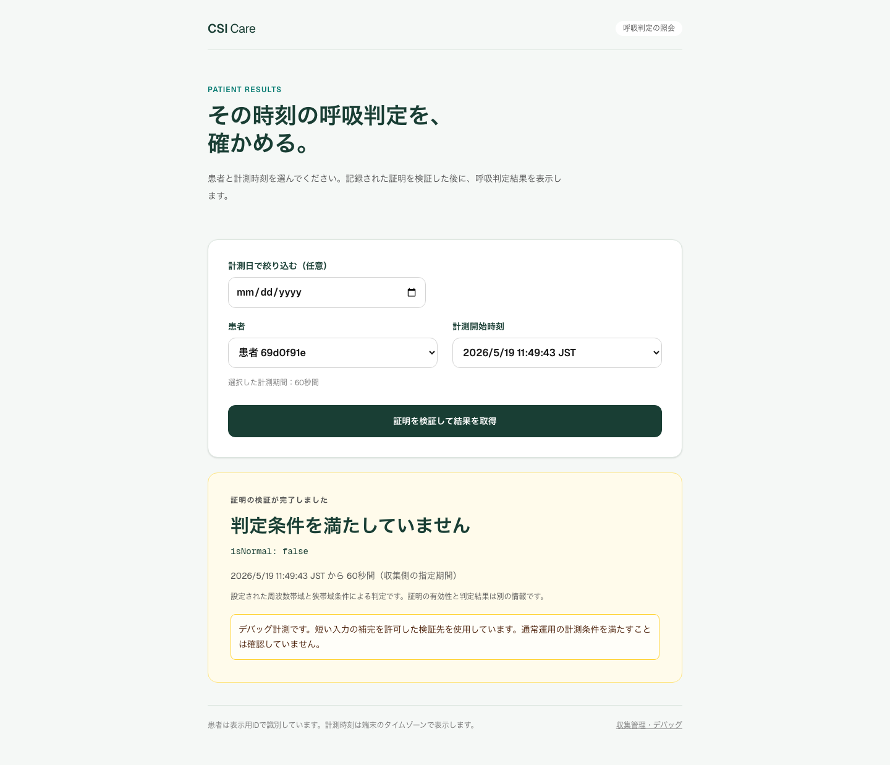

# 患者・計測時刻から呼吸判定を取得するフロー

2026-11-02。既存デバッグ機能を残し、収集端末用クライアント、認証付き収集API、永続キュー、署名ワーカー、証明保存契約、第三者照会画面を実装しました。

## 要件と実装

| 要件 | 実装 |
|---|---|
| CSI取得 | PicoScenesを起動する [収集クライアント](../../../scripts/capture_observation.py)。取得後に認証付きAPIへ送信し、失敗時は同じIDで再送 |
| CSIから証明生成 | [ワーカー](../../../backend/app/services/observation_worker.py) が既存certificate回路でGroth16証明を生成。通常モードではサンプル数・時刻・100 Hz条件を検査 |
| 証明記録 | [BreathingObservationRegistry.sol](../../../backend/contracts/BreathingObservationRegistry.sol)。指定記録者だけが患者参照ID・時刻・証明を登録 |
| 記録した証明の検証 | `verifyObservation` が保存済み証明を実Verifierで検証。有効な場合だけbooleanを返す |
| 第三者の取得 | [API](../../../backend/app/api/endpoints/observations.py) が確認数・患者・時刻の一致を確認し、検証成功時だけ `isNormal` を返す |
| 第三者用Web UI | [PatientResults.tsx](../../../frontend/app/patients/PatientResults.tsx)。患者一覧・計測日・時刻を選択。ログイン不要 |
| デバッグの維持 | 従来画面を残し、`/capture` に患者登録・保存CSI投入・ジョブ照会を追加 |

公開用トップページは患者照会画面。通常の研究構成のトップは既存解析モニターです。回路名・回路IDは新しい計測レコードに保存せず、manifestにデバッグ情報を残します。Verifierコード・アドレス自体は公開チェーンから観察可能です。

## 実行記録

[PC画面](evidence/01-patient-result-desktop.png) / [スマホ画面](evidence/02-patient-result-mobile.png) / [コントラクトのコード画像](evidence/03-record-and-verify-code.png)

画像は実装したUIをブラウザで操作して撮影しました。保存済みのPicoScenesファイルを収集クライアント経由で投入し、Python解析・Groth16生成・ワーカー署名・ローカルEVMへの記録・第三者による再検証を実行しています。API・ウォレット・チェーン結果のモックではありません。

ただし、**このCSIは150サンプルしかないため、デバッグ入力を許可した専用契約での確認です。** 通常モードはこの入力を拒否します。患者IDはテスト用のランダムID、時刻はファイル名から指定、期間60秒は投入時の申告値です。実患者の身元や60秒間の実測を検証した証拠ではありません。今回、新たな無線収集は行っていません。

| 項目 | 実行結果 |
|---|---|
| ネットワーク | ローカルEVM / 31337 |
| 保存 | 成功、記録トランザクションのreceipt.status=1 |
| 記録ガス | 301,274 |
| 第三者検証 | 成功、`status=verified` |
| 公開判定 | `isNormal=false` |
| デバッグ表示 | `debugInput=true`、UIにも明示 |
| 生CSI | 証明生成後にサーバーの一時保存から削除 |
| 詳細 | [実行レスポンス・receipt](evidence/local-result.json) |

## テスト

- Backend: 155件成功、カバレッジ約64%。[ログ](evidence/backend-tests.txt)
- Solidity: 4件成功。実Groth16の記録・第三者検証、不正証明の記録後の検証拒否、未登録、権限、重複、患者の付け替えを確認。
- Frontend: React Testing Library 17件成功。検証前・失敗・未確定時の結果非表示、`false`の正常な取得、選択変更後の古い応答の破棄を確認。
- ブラウザ: 患者照会2件と既存統合3件。PC・スマホ、実チェーンの取得、再照会失敗時の旧結果消去、従来画面の証明引き継ぎを確認。
- lint、TypeScript、通常・公開用の本番ビルド、Compose構文を確認。公開用ビルドのトップページで日付絞り込み・実証明の照会・デバッグ表示も確認。実機収集と公開Sepolia・コンテナ実起動は未確認。

署名済みbytesの送信前永続化、通信失敗後の同一bytes再送、nonce不明時の後続署名停止、キュー上限、入力の重複・競合、保存期限と認証もテストしています。

## 運用で必要な作業と制約

[操作手順](../../PATIENT_OBSERVATIONS.md) に、Sepolia用RPC・記録者鍵の準備、デプロイ、Docker、患者ID登録、PicoScenes端末の設定、失敗時の対応をまとめました。

この構成は単一ホスト・単一署名ワーカーです。患者・計測時刻は収集側の申告を記録者が登録するもので、呼吸回路が患者の身元や時計を証明するものではありません。チェーン上の公開値を検証前に秘密にする機構はありません。

[今回のソース差分](implementation.patch) はコミット `740cdde` からの実装・テスト・運用手順の変更です。画像と進捗ディレクトリ自身は除いています。
