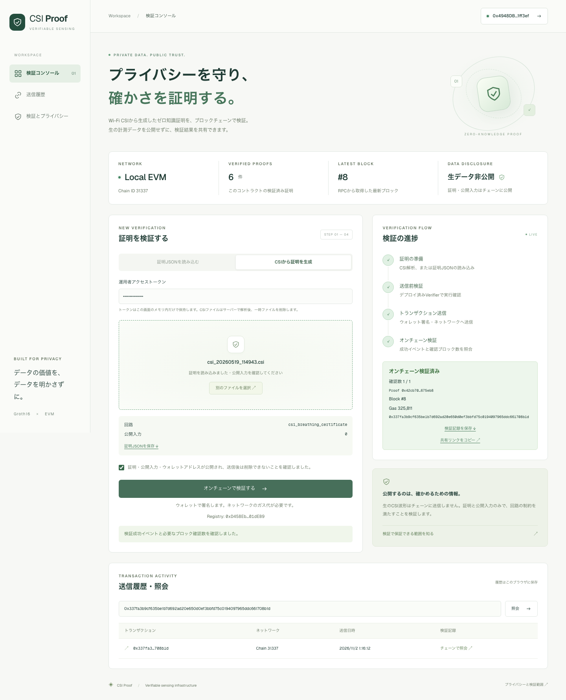
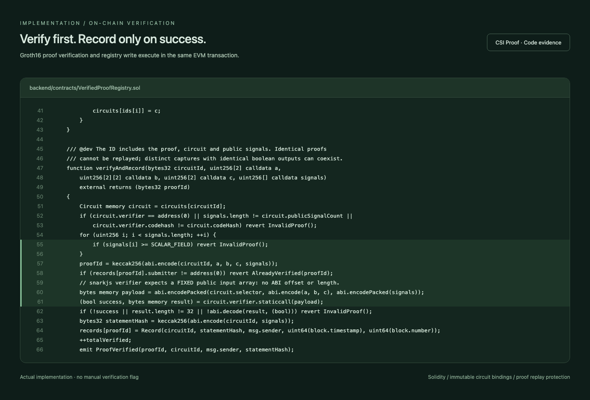

# オンチェーン検証 実装・進捗報告

2026-11-02。CSI解析 → Groth16証明 → ウォレット送信 → Solidity検証 → 検証記録表示まで実装しました。以下の画像は実装したUIをPlaywrightで実際に開いて保存したものです。

## 実測CSIの一連の検証

ローカルのPicoScenesファイルをWeb UIから入力し、Python解析・証明生成・検証トランザクション送信まで確認しました。この計測の公開判定は `0` ですが、証明自体は有効です。

| 項目 | 結果 |
|---|---|
| チェーン | ローカルEVM、Chain ID 31337 |
| 回路 | csi_breathing_certificate |
| 公開入力 | `["0"]`（正常判定とは別に証明の妥当性を検証） |
| Solidity検証 | 成功・ProofVerifiedイベントを確認 |
| 使用ガス | 325,811 |
| 生CSIのオンチェーン送信 | なし |
| 詳細 | [実際のreceipt](evidence/real-csi-local-receipt.json) |

**公開ネットワークへのデプロイではありません。** ブラウザテストではウォレットの通信部分をローカルEVMのテストアカウントへ接続しています。証明生成・契約検証・トランザクション・イベント・receiptは実際に実行しています。MetaMask拡張そのものの操作は未検証です。

## スクリーンショット

| 資料 | 内容 |
|---|---|
| [01 PCコンソール](evidence/01-console-desktop.png) | 接続状態、検証フロー、履歴 |
| [02 改ざん証明の拒否](evidence/02-tampered-proof-rejected.png) | 公開入力を変更した証明をVerifierが拒否 |
| [03 送信前確認](evidence/03-proof-ready.png) | ファイル読込、公開入力、公開への同意 |
| [04 合成信号の検証完了](evidence/04-onchain-verified-desktop.png) | 0.25 Hzの合成波形から実証明を生成して検証 |
| [05 合成信号・モバイル](evidence/05-onchain-verified-mobile.png) | 390 px幅のレイアウト |
| [06 実測CSI・PC](evidence/06-real-csi-verified-desktop.png) | CSIからの全フロー完了 |
| [07 実測CSI・モバイル](evidence/07-real-csi-verified-mobile.png) | 実測CSIの検証記録 |
| [08 Solidityコード](evidence/08-contract-code.png) | 実ファイルから作成したコード画像 |

## コードの中心部分

| ファイル | 実装 |
|---|---|
| [VerifiedProofRegistry.sol](../../../backend/contracts/VerifiedProofRegistry.sol) | Verifier呼出しと記録の原子性、回路固定、同一証明の重複拒否 |
| [build.mjs](../../../backend/contracts/scripts/build.mjs) / [deploy.mjs](../../../backend/contracts/scripts/deploy.mjs) | zkeyからVerifier生成、デプロイ、manifest出力 |
| [onchain_service.py](../../../backend/app/services/onchain_service.py) | BN254入力検証、送信前実行、receipt・確認数照合 |
| [onchain.py](../../../backend/app/api/endpoints/onchain.py) | 公開用の検証API |
| [VerificationConsole.tsx](../../../frontend/app/verify/VerificationConsole.tsx) | レスポンシブUI、ウォレット署名、履歴、共有 |
| [public.conf](../../../nginx/public.conf) | 公開APIの許可リスト、容量・レート制限 |
| [docker-compose.public.yml](../../../docker-compose.public.yml) | 公開用構成、研究サービスとの分離 |

[今回のコード差分](implementation.patch) は進捗レビュー用スナップショットです。依存ロック・画像は除き、今回変更したソースだけを収録しています。作業開始時から存在していたユーザーの削除・未追跡研究ファイルは含めません。

## 検証結果

- バックエンド: **146テスト成功**、既存カバレッジ条件を達成（約63%）。[ログ](evidence/backend-tests.txt)
- コントラクト: 実Groth16証明の成功、公開入力改ざん、不正座標、入力数不一致、field範囲外、未登録回路、実トランザクションのrevert、同一証明の重複を確認。[ログ](evidence/contract-tests.txt)
- ブラウザ: 合成信号の全フロー、無効JSON・未接続時の失敗表示、実測CSIからの全フロー、モバイル横幅、履歴からの再照会、入力変更時の旧成功状態クリア。
- フロントエンド: lint、TypeScript、本番ビルドに成功。React Testing Library 3件成功。失敗時の送信抑制を検証。
- Next.jsを16.4.3へ更新。フロントエンドの `npm audit --omit=dev` は検出0件。開発用ESLint依存のmoderate指摘は残っています。バックエンド・ZKP依存を含む包括的な監査を完了したという意味ではありません。
- 公開Compose: 構文検証済み。作業環境のDocker daemonが停止しているため、コンテナのビルド・起動は未検証です。

## 公開前に必要な設定

公開チェーン・RPC・デプロイ用資金、TLS・ドメイン、運用者トークン、対応するtrusted setup鍵の検証が必要です。独立したセキュリティ監査は未実施です。現時点で本番ネットワークへ公開済みとは扱わないでください。

起動・デプロイ・証明JSONの形式・APIの詳細は [運用手順](../../ONCHAIN_VERIFICATION.md) に記載しています。

## 追記: テストネットを使用する方針

公開検証先をEthereum Sepolia（11155111）に設定。専用コマンド `npm run deploy:sepolia --prefix backend/contracts` と `.env.sepolia.example` を追加しました。デプロイ・APIはSepoliaとローカルEVMだけを許可します。UIにもテストネット／ローカルの区分を表示します。

Sepolia用RPC・デプロイ用ウォレットの設定がないため、実デプロイは未実施です。既存画像・receiptは引き続きローカルEVMでの実行記録です。

追記分の確認結果: ネットワーク制限のNodeテスト2件、オンチェーンAPI関連Pythonテスト20件、frontend lint/type-checkに成功。
[ネットワーク区分の画面](evidence/09-network-classification-local.png) は実際のローカル接続です。[テストネット対応後のソーススナップショット](testnet-source-snapshot.patch) はGit HEAD比の全内容を含み、前回のpatchへ重ねて適用する差分ではありません。
