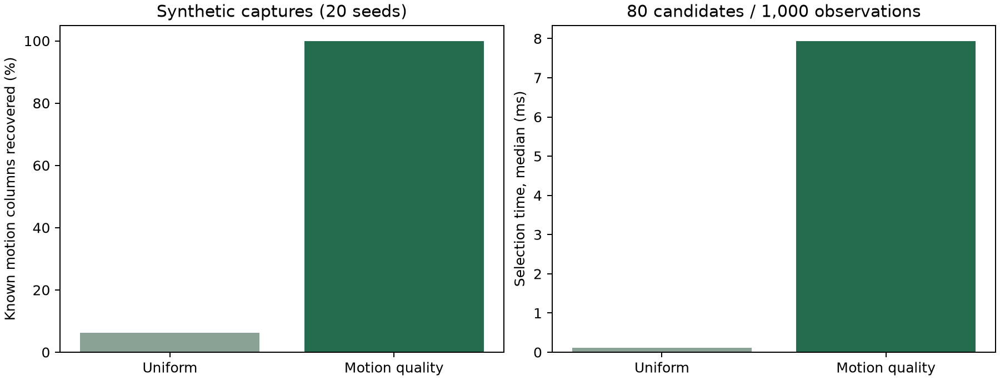

# サブキャリア選択の改善（2026-11-09）

既定の選択を、等間隔8列から `motion-quality-v1` に変更しました。全候補の振幅変化を正規化し、外れ値とノイズを減点し、波形の重複も考慮して8列を選びます。**選択自体はPythonで行い、Circomの証明対象には含めていません。**

[実装の詳細・数式・再現手順](../../LOMB_SCARGLE_SUBCARRIER_SELECTION.md) ／ [比較の全数値](comparison.json) ／ [実CSIのGroth16証明](real-csi-proof.json) ／ [検証記録](validation.json)

## 比較結果

80候補・1,000観測の合成CSIで、ランダムな位置の8列にだけ振幅変調を与えました。白色ノイズ・大きな静止信号・極小振幅・単発スパイクも含む20seedの比較です。

| 指標 | 従来の等間隔 | 新方式 |
|---|---:|---:|
| 動きのある既知の8列を選択できた平均割合 | 6.25% | 100% |
| 選択処理時間・中央値 | 0.115 ms | 7.941 ms |

この100%は制御された合成例での結果であり、実環境での認識率・呼吸精度ではありません。新方式は等間隔選択より計算量が増えます。選択する8列の情報の質を改善し、Lomb–Scargle回路の処理本数は8本に維持する狙いです。

[図のSVG版](comparison.svg)

## 実CSI・回路検証

保存済みCSIの最頻幅4,004列・150観測から8列を選択し、元のI/Qを64観測へ整形しました。前処理で使ったクリップ済み波形を回路に渡すことはしていません。

- 従来方式・新方式それぞれの合成CSIと実CSI、計4ケースでwitnessとR1CSの制約チェックに成功。
- 新方式の実CSIでGroth16証明生成・検証に成功。`isNormal=false` は有効な証明の判定値であり、検証失敗ではありません。
- Backend 182 tests passed（選択処理の12件を含む）。Frontend lint・type-checkも成功。
- 実行時間：witness約1秒、proof約30秒、verify約1秒（秒単位の参考値、1回の実行）。
- 回路ソース、WASM、鍵、公開信号69個の形式は変更なし。制約数は807,453のまま。
- 実CSIには体動・呼吸の正解ラベルがないため、判定値から実データの精度改善を主張しません。

## 変更した部分

- `edge/lomb_scargle_e2e/bin/select_subcarriers.py`：品質スコア・決定論的順位・重複減点。
- `edge/lomb_scargle_e2e/bin/prepare_input.py`：全候補を評価する入力経路、最大1,088行の全幅バッファ、I/Q・時間整合性検査。
- `edge/lomb_scargle_e2e/bin/prove.sh`：新方式を既定化、`CSI_SUBCARRIER_SELECTION=uniform` で旧方式、任意のローカル診断ファイル。
- `scripts/benchmark_subcarrier_selection.py`：再現可能な比較・witness検査・図の出力。
- `backend/tests/unit/test_edge_subcarrier_selection.py`：ノイズ・外れ値・帯域に依存しない選択・決定性・非有限値・時間情報・旧方式互換・メモリ上限・量子化を検査。
- edgeパッケージのREADME・VERSION・MANIFESTを更新。回路や鍵の更新は不要。

診断メタデータの選択列・スコアは公開proof JSONに混ぜず、ローカルに0600で保存します。公開 `selectedSubcarrier` は選択した8列内の番号です。複数アンテナのflatten後の元列番号・RFサブキャリア番号とは区別してください。
